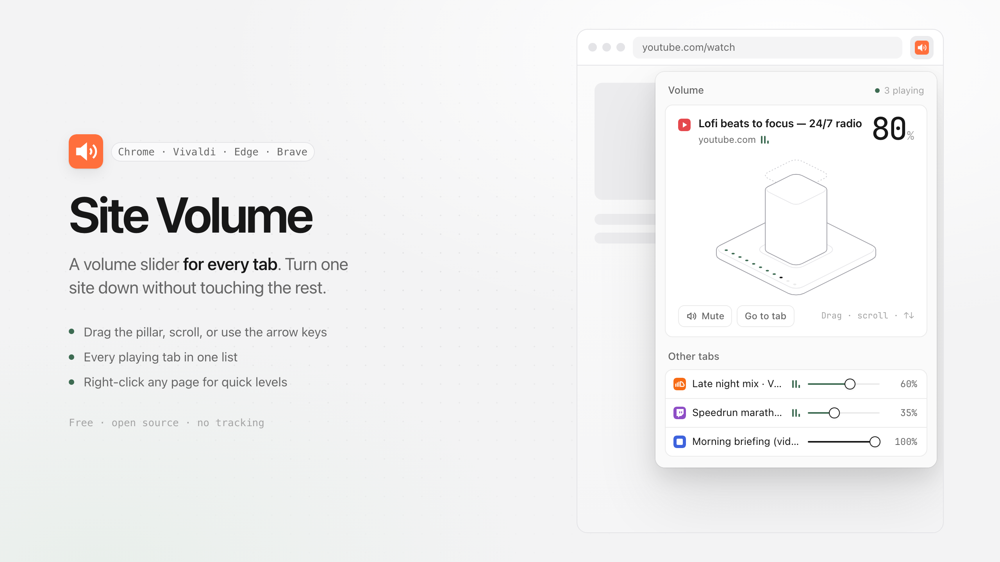

<h1 align="center">Site Volume</h1>

A volume slider for every tab. Turn one site down without touching the rest.

<a href="../../releases/latest"><b>Download the latest release</b></a> · Chrome · Vivaldi · Edge · Brave · Arc

## What it does

- **Every playing tab in one place.** Click the toolbar icon: the tab you're on gets a big volume pillar, every other tab with a player sits in a list below with its own slider.
- **Drag, scroll, flick or use the arrow keys.** The pillar catches lightly on every 10%, and a flick carries on to the next step.
- **Right-click any page** for quick levels (100% down to mute) without opening the popup.
- **Works with sites that fight back.** YouTube and others keep resetting their player's volume; Site Volume multiplies on top of the site's own level, so the site's slider still works and nothing gets overwritten.
- **Nothing is saved, nothing leaves your browser.** Each tab keeps its level while it's open; a new tab or reload starts at 100%. No tracking, no network calls.

## Install

Not on the Chrome Web Store yet, so it installs as an unpacked extension (takes a minute):

1. Download **`site-volume-vX.Y.zip`** from the [latest release](../../releases/latest) and unzip it.
2. Open your browser's extensions page:
   - Chrome: `chrome://extensions` · Vivaldi: `vivaldi://extensions` · Edge: `edge://extensions` · Brave: `brave://extensions`
3. Turn on **Developer mode** (top right).
4. Click **Load unpacked** and pick the unzipped folder.
5. Pin the icon to your toolbar. Tabs that were already open need one reload before they can be controlled.

## Permissions, and why

| Permission | Why |
| --- | --- |
| Read and change data on all sites | A small script runs on each page so it can reach the audio and video players there. It only touches player volume. |
| Tabs | To list which tabs are playing, with their title and icon. |
| Context menus | The right-click "Site volume" menu. |

## How it works

`page.js` runs inside each page before the site's own code and wraps the browser's `volume` setting on audio and video players: whatever the site asks for is multiplied by your level. `content.js` passes your level from the popup to the page. The pillar is drawn with [Hairline](lib/HAIRLINE-LICENSE) by Lucas Marques (MIT).

The demo video and images are rendered from the real popup with a fake browser behind it: see [`promo/`](promo) (`node promo/record.mjs`, needs `playwright-core` and `ffmpeg`).

## License

MIT
